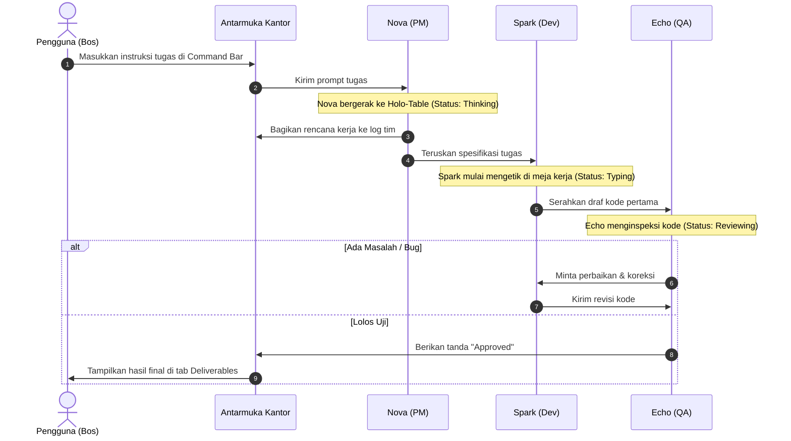

# 📋 Product Requirement Document (PRD)
## Project: Mini AI Office (Pixel Space Agency) — v1.0 MVP

---

## 1. 🎯 Visi & Tujuan Proyek
Membangun antarmuka kantor virtual agen AI berbasis web yang ringan, interaktif, dan estetik dengan gaya **Cozy Pixel Art x Futuristic Clean Space**. Proyek ini mendemostrasikan kolaborasi multi-agen (*autonomous multi-agent collaboration*) yang dapat menyelesaikan tugas perangkat lunak secara terstruktur menggunakan model AI gratis, serta dapat di-deploy tanpa biaya server di Vercel.

---

## 2. 👥 Tim Agen (Agent Roster MVP)

Untuk menjaga performa dan mematuhi batasan *Free Tier* Gemini (15 RPM), tim dibatasi menjadi **3 peran inti** (arsitektur modular disiapkan untuk ekspansi di v1.1):

| Agen | Avatar Style | Peran & Tanggung Jawab | Output Utama |
| :--- | :--- | :--- | :--- |
| **🧑‍💼 Nova (Lead Architect & PM)** | Pixel Cyan Uniform | Menganalisis instruksi bos, merumuskan spesifikasi teknis, membagi tugas. | *Task Breakdown & Plan* |
| **💻 Spark (Full-Stack Builder)** | Pixel Orange Hoodie | Mengimplementasikan logika, menulis kode bersih, dan menyusun file. | *Draft Code & Solution* |
| **🕵️ Echo (QA & Code Reviewer)** | Pixel Violet Visor | Menguji fungsionalitas, mencari bug/celah keamanan, memberikan approval final. | *Review Notes & Approval* |

---

## 3. 🎨 Desain Visual & Antarmuka (UI/UX)

### 3.1. Tema & Estetika
* **Art Style:** Cozy 16-bit Pixel Art.
* **Atmosphere:** *Futuristic Clean Space Station* (lantai putih/slate minimalis, aksen neon cyan/amber halus, meja konsol kaca, tanaman hydroponic kecil di sudut).
* **Indikator Status Agen:**
  * 💤 *Idle* (Duduk santai di meja)
  * 💭 *Thinking* (Balon pikiran berdenyut)
  * ⚡ *Typing / Working* (Animasi mengetik konsol)
  * 💬 *Speaking* (Balon dialog pixel muncul di atas kepala)

### 3.2. Layout Layar (Split Layout)
* **Area Kiri / Atas (Visual Office Canvas):**
  * Menampilkan ruangan kantor mini berdimensi tetap (responsive).
  * 3 meja kerja dengan komputer/konsol futuristik.
  * Meja rapat bundar (*Holo-table*) di tengah ruangan untuk sesi briefing/review.
* **Area Kanan / Bawah (Control & Communication Center):**
  * **Tab 1: Live Chat & Discussion Log** (Melihat obrolan transparan antar-agen secara real-time).
  * **Tab 2: Deliverables** (Tempat hasil kode/solusi akhir disajikan secara rapi dengan *syntax highlighting* dan tombol copy).
  * **Bottom Bar:** Input perintah bos (*"Tugaskan tim..."*) + tombol *Execute* + tombol *Emergency Stop*.
  * **Header:** Status koneksi API + Tombol *Settings* (Modal input Gemini API Key).

---

## 4. ⚙️ Arsitektur Teknis & Stack

* **Frontend Engine:** HTML5, Modern Vanilla CSS (Custom Design System, Zero-dependency), JavaScript (ES Modules) atau Svelte.
* **Rendering Visual:** Canvas 2D / CSS Grid & Pixel Sprite Animation (sangat ringan, 60fps, load instan).
* **AI Engine:** Google Gemini 1.5 Flash API (*Direct Client-Side Execution*).
* **Penyimpanan Kredensial:** `localStorage` browser pengguna (Aman untuk deployment publik di GitHub/Vercel, tidak ada API key yang bocor di kode).
* **Deployment Target:** Vercel (100% Free Static Hosting).

---

## 5. 🔄 Alur Kerja Pengguna (User Flow)

---

## 6. 🛡️ Penanganan Error & Batasan Sistem
1. **Rate Limit Handling:** Jeda minimum 3–4 detik antar pesan agen untuk mencegah limit 15 RPM pada API gratis Gemini.
2. **Infinite Loop Safeguard:** Maksimal 3 siklus revisi antara Dev dan QA. Jika siklus ke-3 tercapai, QA diwajibkan memberikan persetujuan dengan catatan catatan perbaikan minor.
3. **Emergency Stop:** Tombol pembatalan (*AbortController*) di UI yang menghentikan panggilan API yang sedang berjalan.

---

## 7. 🗺️ Roadmap & Milestone Implementasi

* [ ] **Fase 1: Prototype Visual Sample (Checkpoint Persetujuan)**
  * Membuat layout dasar dan render 1 ruangan kantor pixel mini futuristik beserta 3 karakter statis untuk disetujui tampilannya.
* [ ] **Fase 2: State & Animation Engine**
  * Membuat sistem perubahan status visual (Idle, Walk, Typing, Balon Chat) pada karakter.
* [ ] **Fase 3: API Integration & Prompt Engineering**
  * Modal input API key di `localStorage`.
  * Integrasi Gemini 1.5 Flash untuk Nova, Spark, dan Echo dengan prompt peran masing-masing.
* [ ] **Fase 4: Multi-Agent Orchestration & Deliverables UI**
  * Alur komunikasi otomatis (PM -> Dev -> QA -> Output).
  * Panel hasil akhir yang bisa disalin (*copy-to-clipboard*).
* [ ] **Fase 5: Polish, Testing & Vercel Deployment**
  * Uji coba responsivitas, audio click/retro pixel beeps (opsional), dan panduan push ke Vercel.
